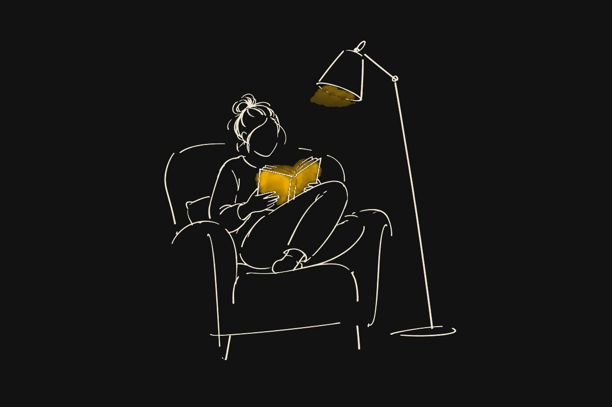
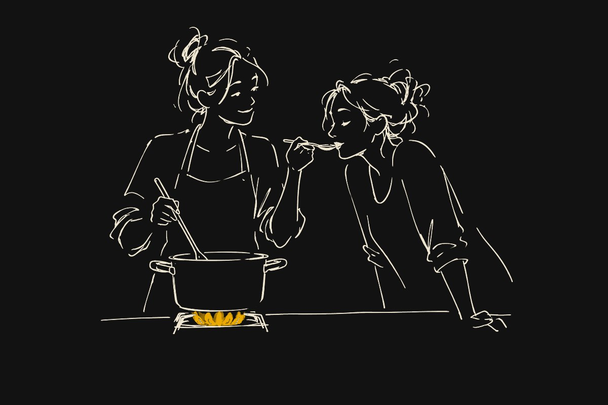
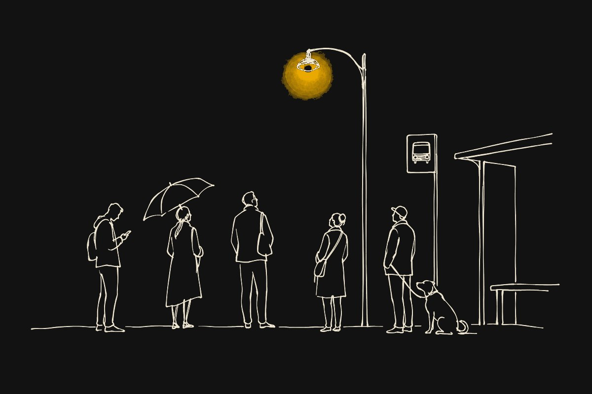

# Hand-drawn illustration skill

An agent skill for generating hand-drawn ink illustrations with an image model, by [Icey Zhao](https://www.linkedin.com/in/icey).

One hand, two modes:

- **Quiet**: a pared-down designer's sketch. A few fast fineliner strokes, open lines, no shading, faces left blank, and exactly one accent, which is always a light. Made to sit beside real work (a product, a headline) and on dark pages without competing.
- **Lively**: an expressive editorial illustration. Variable line pressure, gesture and wit, a small story told by one clear action, one restrained accent.

The skill explains when to use each, gives a prompt foundation for both, and includes `scripts/ink_to_dark.py`, which turns a black-ink sketch on white into transparent light lines for dark pages, keeps the accent colour, and can soften a small accent dot into a glowing light.

## Examples (Quiet mode, converted for a dark page)

| A reading lamp | Cooking together | The bus stop |
|---|---|---|
|  |  |  |

## Install

Copy the `hand-drawn-illustration` folder into your agent's skills directory, for example `~/.claude/skills/hand-drawn-illustration/` for Claude Code, or a project's `.claude/skills/`.

The conversion script needs Python with Pillow:

```bash
pip install pillow
python hand-drawn-illustration/scripts/ink_to_dark.py sketch.png sketch-dark.png
```

The example images were generated with an image model from the prompts in the skill.

## License

[CC BY 4.0](https://creativecommons.org/licenses/by/4.0/): free to use and adapt, with credit to Icey Zhao.
